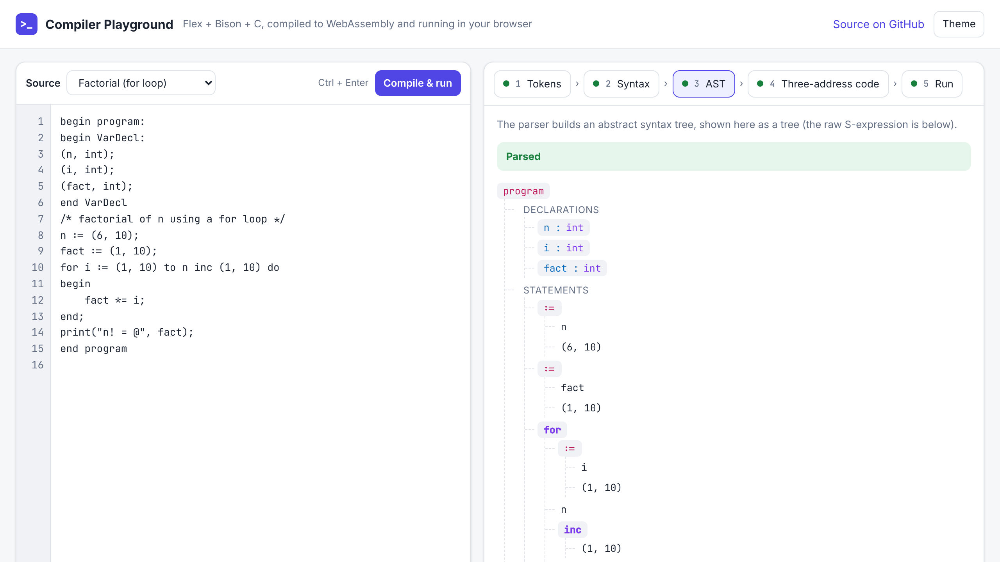

# compiler-construction

A small compiler for a toy Pascal-ish language, built with Flex, Bison and C. It goes all the way from raw text to running the program: lexer, parser, AST, three-address code, and an interpreter with a symbol table.

**Try it in the browser:** https://rushipatel296.github.io/compiler-construction/

[](https://rushipatel296.github.io/compiler-construction/)

The playground runs the actual C code, compiled to WebAssembly, so what you see there is exactly what the native binaries print.

## What the language looks like

```
begin program:
begin VarDecl:
(n, int);
(i, int);
(fact, int);
end VarDecl
n := (6, 10);
fact := (1, 10);
for i := (1, 10) to n inc (1, 10) do
begin
    fact *= i;
end;
print("n! = @", fact);
end program
```

Integers carry their base (`(1010, 2)` is 10), identifiers are lowercase with at most one underscore, and `@` in a print string is where the value goes. More programs live in [`examples/`](examples).

## Stages

| Folder | What it does |
| --- | --- |
| [`lexer/`](lexer) | Standalone Flex scanner. Prints every token with its type and flags bad identifiers, invalid base constants, redeclared variables and malformed `print`/`scan` statements. |
| [`parser/`](parser) | Bison grammar for the whole language. Accepts the program or reports the first syntax error with its line. |
| [`ast/`](ast) | Same grammar, builds an abstract syntax tree and prints it as an S-expression. |
| [`codegen/`](codegen) | Syntax-directed translation to three-address code with temporaries and labels. |
| [`interpreter/`](interpreter) | Builds the AST and a symbol table, checks types and initialization, then executes the program. |

## Build and run

You need `gcc`, `make`, `flex` and `bison`.

```
make                                  # builds all five stages
make run INPUT=examples/factorial.txt # runs every stage on one file
./interpreter/interpreter examples/loops.txt
```

Each folder also has its own `Makefile` (`make -C codegen run INPUT=../examples/if-else.txt`).

## The web playground

The page lives in [`docs/`](docs) and is plain HTML/JS. `make wasm` (needs [Emscripten](https://emscripten.org)) recompiles every stage into `docs/wasm/`. Each run happens in a fresh Web Worker, so an infinite loop just times out instead of freezing the tab.

## Notes

- `scan` is checked by the lexer and parser but the interpreter doesn't execute it.
- `print` in the interpreter takes one expression.

Built with Daksh Jain, Khush Bhuta and Utkarsh Singhal.
